# icdu

A disk usage explorer for the terminal that you can use **while it is still scanning**, and
that is compatible with [ncdu](https://dev.yorhel.nl/ncdu).

- **Browse while it scans.** The list is on screen at once. Sizes fill in and add up as the
  scan goes on, and the directory you enter is scanned next, so what you are looking at is
  finished first. On a large filesystem there is no waiting in front of a progress display.
- **Search the whole tree by name.** `/` finds entries anywhere below, largest first, as you
  type, including what the scan has only just reached. Enter takes you there.
- **Compatible with ncdu.** Its keys and command-line options work, its config files are
  read, and its JSON dumps are read and written without loss.

<p align="center">
  
</p>

<p align="center"><sub>Recorded on a sample tree with <code>tools/demo/record.sh</code>. The tree is small, so
the scan was slowed down for the recording; everything on screen is what icdu drew.</sub></p>

## Install

```sh
curl -fsSL https://raw.githubusercontent.com/anhofmann/icdu/main/install.sh | sh
```

The script detects your platform (macOS Apple Silicon/Intel, Linux x86-64/ARM64), downloads the
static binary from [Releases](https://github.com/anhofmann/icdu/releases), verifies its
SHA-256 checksum, and installs it to `~/.local/bin`. Override the destination with
`ICDU_INSTALL_DIR=...` or pin a version with `ICDU_VERSION=v0.5.0`. From source with a Rust
toolchain instead: `cargo install --git https://github.com/anhofmann/icdu`.

To upgrade, run the install script again: it replaces the binary with the latest release. There
is no built-in updater, and icdu itself never connects to the network.

### Upgrading from rcdu

Up to version 0.4.1 this program was called rcdu. Coming from it:

- Install icdu with the script above, then remove the old binary (`rm ~/.local/bin/rcdu`).
  `rcdu update` cannot do this step: it does not find releases published under the new name.
- The self-update command is gone. Upgrade by running the install script again.
- The install script reads `ICDU_VERSION` and `ICDU_INSTALL_DIR`. Releases up to v0.4.1 stay
  available: asked for one of them, the script installs it under its old name.
- Some keys changed to match ncdu: `Esc` no longer quits, `/` is the only search key (the
  filter is part of the search now), export is on `E`, the largest files on `T`, and `r` and `b`
  act on the directory you are viewing. `s` sorts by size and `n` by name (`s` used to switch
  between the two), and names are in natural order. The full list is under [Keys](#keys).
- Exports written from the UI are named `icdu-dump.json`, and dumps carry `icdu` as the program
  name. Dumps written by rcdu load as before.
- `--exclude` patterns also see the path, as in ncdu: one with a `/` in it now has an effect,
  and a pattern with a wildcard can match across directories (`lib*.so` also matches
  `lib/x/y.so`). An exclude file (`-X`) no longer has comments, and its lines are not trimmed.

## Usage

```
icdu [OPTIONS] [PATH]

ARGS:
    PATH                     directory to scan (default: current directory)

OPTIONS:
    -t, --threads N          scanner threads (default: cores*4)
    -a, --apparent-size, --disk-usage
                             show apparent sizes, or disk usage (default)
    -x, --one-file-system, --cross-file-system
                             stay on one filesystem, or cross (default)
        --exclude PATTERN    exclude entries matching a glob (repeatable)
    -X, --exclude-from FILE  read exclude patterns from FILE (one per line)
        --exclude-caches, --include-caches
                             leave out directories that have a CACHEDIR.TAG
        --exclude-kernfs, --include-kernfs
                             leave out Linux pseudo filesystems (/proc, /sys)
    -L, --follow-symlinks, --no-follow-symlinks
                             count a symlink to a file as that file
        --older-than DUR     exclude entries older than DUR (e.g. 30d, 2w, 1y)
        --newer-than DUR     exclude entries newer than DUR
    -r, --read-only          no deleting; given twice: no shell or export either
        --disable-delete, --enable-delete
                             turn the delete key off, or on (default)
        --disable-shell, --enable-shell
                             turn shell and opener off, or on (default)
        --disable-refresh, --enable-refresh
                             turn rescanning off, or on (default)
        --delete-command CMD run CMD on the path instead of deleting it
        --confirm-quit, --no-confirm-quit
                             ask before quitting, or not (default)
        --confirm-delete, --no-confirm-delete
                             ask before deleting (default), or not
        --si, --no-si        sizes in powers of 1000 (kB, MB), or of 1024
        --color SCHEME       off, dark or dark-bg (off if NO_COLOR is set)
        --show-hidden, --hide-hidden
                             list dot files and excluded entries, or not
        --show-graph, --hide-graph
                             show or hide the size bar (default: show)
        --show-percent, --hide-percent
                             show or hide the percentage (default: show)
        --graph-style STYLE  the bar: hash, half-block or eighth-block
        --sort COLUMN        disk-usage, name, apparent-size, itemcount, mtime
        --group-directories-first, --no-group-directories-first
                             list directories before files, or not (default)
        --disable-natsort, --enable-natsort
                             order names byte by byte: file10 before file2
        --show-itemcount, --hide-itemcount
                             show or hide the item count column (default: hide)
    -o, --output FILE        scan without UI, write ncdu JSON (- is stdout)
    -f, --file FILE          browse a tree from ncdu JSON (- is stdin)
    -0                       no feedback while scanning (default with -o -)
    -1                       one line of progress (default with -o FILE)
    -2                       browse while scanning (default)
    -q, --slow-ui-updates, --fast-ui-updates
                             update the screen every 2 s, or 10 times a second
    -e, --extended, --no-extended
                             record owner, group, mode and mtime of entries
        --show-mtime, --hide-mtime
                             show or hide the mtime column (needs -e)
        --ignore-config      do not read the config files
    -h, --help               show this help
    -V, --version            show version
```

While a scan runs, icdu shows what ncdu shows: the live browser by default (`-2`); with `-o FILE`
one line of progress on the terminal (`-1`); and with `-o -` nothing at all (`-0`), so that a
pipe or a cron job gets only the dump. Each of the three can be asked for explicitly. `-0` and `-1`
without `-o` scan first and open the browser when the scan is done. `-q` redraws the screen only
every two seconds while scanning, which helps over a slow remote connection.

Options are written as in ncdu: short flags can be bundled, and a value can be attached to its
flag or follow it (`-xo-`, `-o file`, `--exclude=tmp`, `--exclude tmp`). `--` ends the options.
Of two options that contradict each other the later one wins, and every option that switches
something has a counterpart that switches it back (`--apparent-size` / `--disk-usage`, `-x` /
`--cross-file-system`, `-e` / `--no-extended` and so on). A usage error exits with status 1.

`-t` sets the number of scanner threads. It defaults to four per core (at least 4, at most
64); ncdu 2 uses one unless told otherwise.

Options you always want can go into a config file; see [Configuration](#configuration).

Examples:

```sh
icdu /                          # browse / live, on-disk usage
icdu ~ --exclude .cache --exclude node_modules
icdu / -x -o backup.json        # headless scan of the root filesystem only → JSON
icdu -f backup.json             # browse a previous dump, no scanning
ncdu -o - / | icdu -f -         # pipe an ncdu scan straight into icdu
icdu -f old.json -o new.json    # re-read and rewrite a dump (recomputes totals/dedup)
```

### Configuration

Default options are read from config files, in ncdu's format: one option per line, written as
on the command line, with its value after it on the same line.

```
# Always record owner, mode and time
-e
# The value is the rest of the line, as it stands: no quotes
--exclude My Documents
--sort name
# A line with @ in front may fail: this file need not exist
@--exclude-from ~/.ncduexcludes
```

Empty lines and lines that start with `#` are passed over. In a file name, `~/` is your home
directory. Options that belong to one run (`-o`, `-f`, `--help`) cannot be set there.

Four files are read, each overriding the ones before it, and the command line overrides them
all (that is what the counterparts are for: `--no-extended` undoes a `-e` from a file):

1. `/etc/ncdu.conf` and
2. `$XDG_CONFIG_HOME/ncdu/config` (`~/.config/ncdu/config` if the variable is not set): ncdu's
   own files, so that a setup you have for ncdu applies to icdu as well. What icdu cannot
   use in them, such as an option of a newer ncdu, is reported and passed over.
3. `/etc/icdu.conf` and
4. `$XDG_CONFIG_HOME/icdu/config` (`~/.config/icdu/config`): for what icdu is to do
   differently, and for options ncdu does not have (`--older-than`, `--newer-than`), which
   would stop ncdu if they stood in its file. A mistake in these stops icdu, with the file and
   the line.

`--ignore-config` reads none of them.

### Keys

| Key | Action |
|-----|--------|
| `j` / `k`, `↓` / `↑` | move selection |
| `l` / `Enter` / `→` | enter directory |
| `h` / `<` / `Backspace` / `←` | go up |
| `Home` / `End`, `G` | jump to top / bottom |
| `PgUp` / `PgDn`, `Ctrl-d` / `Ctrl-u` | page up / down |
| `s` | sort by size (the one on screen); again reverses the order |
| `n` | sort by name; again reverses |
| `C` | sort by the number of items; again reverses |
| `M` | sort by modification time (needs `-e`); again reverses |
| `t` | directories first, or not |
| `/` | search by name; `Enter` jumps to the selected match, `Tab` limits the search to the current directory |
| `]` / `[` | go to the next / previous match of the last search |
| `a` | toggle apparent size ↔ on-disk usage |
| `e` | show or hide hidden entries: dot files, and what the scan excluded |
| `g` | bar and percentage: both, neither, the bar, the percentage |
| `c` | toggle the item count column (entries below each directory) |
| `m` | toggle the modification time column (needs `-e`) |
| `d` | delete selected entry (asks to confirm) |
| `T` | show the largest files under the current directory |
| `r` | rescan the current directory in place |
| `i` | show details of the selected entry |
| `E` | export the tree to an ncdu-format JSON file |
| `x` | jump to the next read-error entry (`!` marker), wrapping around; the footer shows the reason |
| `b` | spawn a shell in the current directory |
| `o` | open selected entry (default app; directories in the file manager) |
| `?` | show the help dialog (it scrolls with `j` / `k` when the terminal is too small for it) |
| `q` | quit |
| `Esc` | close a popup (it never quits) |
| `Ctrl-l` | redraw the screen |
| `Ctrl-z` | suspend to the shell; `fg` brings the UI back |

A letter typed with Ctrl or Alt is never taken for the plain letter: `Ctrl-e` does not export and
`Alt-d` does not delete. The only such combinations that do anything are `Ctrl-c`, `Ctrl-d`,
`Ctrl-u`, `Ctrl-l` and `Ctrl-z`.

When icdu is ended from outside (`kill`, a closed terminal window), it gives the terminal back
in a usable state first.

Every row starts with a flag, the same ones as in ncdu, and the name of a directory starts
with `/`:

| Flag | Meaning |
|---|---|
| `!` | the directory or entry could not be read |
| `.` | something further down could not be read, so the size may be too small |
| `<` | excluded: by a pattern, as a cache directory, or by the mtime filters |
| `>` | a directory on another filesystem, not entered (`-x`) |
| `^` | a kernel filesystem, not entered (`--exclude-kernfs`) |
| `H` | a hard link whose file is counted at another of its names |
| `@` | neither a file nor a directory: a symlink, device, socket or fifo |
| `e` | an empty directory |
| `F` | a firmlink (only in dumps that ncdu wrote on macOS) |

A directory that has not been read yet is not flagged as empty.

### While the scan is running

Sizes are live, so the screen says which of them are final:

- A directory whose size is followed by `…` and shown dimmed has not been read completely
  below. Its size is still growing, and `d` and `r` are not available on it yet. If you
  press one of them anyway, icdu says how many directories are left in it, reads that
  directory before anything else, and tells you in the footer when it is ready. It does not
  delete on its own: you press `d` again.
- The header shows how many directories below the one you are viewing are still to be read
  (`2,281 directories left to read`). The number shrinks to nothing as the scan gets there.
- The title of the list describes the directory itself: `reading…` until its entries have
  arrived, then the number of items, `(empty)`, `(unreadable)` or `(excluded, not scanned)`.
  A directory with a great many entries arrives in parts; while more are coming the title
  reads `8,192 items · reading…`.

The same `…` marks unfinished directories in the search results.

The footer shows what the scan has done and what is left: the size found per second (in the
metric on screen), directories and files seen, and the number of directories still to be read in
the whole tree. A status message shares the line with this progress and does not hide it.

### Shelling out

Press `b` to suspend the TUI and run a shell interactively in the directory you are viewing
(as ncdu does) — find it here, fix it there, `exit` to come straight back into icdu. The scan keeps running in the
background while you're away, up to a limit on what it queues for the display, and carries on
when you return.

Which shell is decided as in ncdu: the command in `NCDU_SHELL` if that is set (any command
line, run by `/bin/sh -c`, for example `NCDU_SHELL='vifm .'`), otherwise `$SHELL`, otherwise
`/bin/sh`. The shell gets `NCDU_LEVEL` in its environment, 1 or one more than icdu itself was
started with, so a prompt can show that it runs inside icdu.

By default sizes are **on-disk usage** (`st_blocks × 512`); press `a` for apparent size.
Symlinks are never followed (counted as the link itself), matching ncdu's default.

### Searching

Press `/` to ask: *where in this tree is anything called X?* Type part of a name. Case is
ignored for every letter (`übung` finds `Übung.pdf`), and an accented letter is found whether
the name stores it as one character or, as macOS does, as a letter with a combining mark.

100 ms after your last keystroke every entry in the tree is searched, and the matches are
listed with their path and size, largest first, with the matched part highlighted.
`↑`/`↓` and `PgUp`/`PgDn` move (letters all go to the query), `Enter` jumps to the directory
containing the selected match with it highlighted, and `Esc` closes the popup without moving.
To edit the query, `Backspace` deletes a character, `Ctrl-w` the last word and `Ctrl-u` the
whole line. Pasted text goes into the query as it is, without its line breaks.

The search is kept when the popup closes. `/` opens it again with its query, its matches and
the highlighted row as you left them, and `]` and `[` step to the next and the previous match
straight from the browser, wrapping around at the ends. The footer says where you are:
`match 3 of 57: readme`. Matches that have been deleted or rescanned away are passed over.

`Tab` switches what is searched: the whole tree (the default), or only what lies below the
directory you are viewing. Limited to a directory, paths are shown relative to it. The title
always names the scope, for example `12 matches under node_modules/`. This is the way to narrow
down a huge directory: go into it, press `/`, then `Tab`.

The search runs in slices between frames, so the UI stays responsive even on trees with
millions of entries; the title shows the match count and progress. While a scan or rescan is
running, new matches appear as they are discovered, and entries you delete or rescan away
drop out of the list. A very broad query lists its 10,000 largest matches and says how many
there are in all: `123,456 matches in the whole tree, showing the largest 10,000`.

### Sorting

The list is sorted by the size it shows, largest first. `s`, `n`, `C` and `M` select the column
to sort by (size, name, item count, modification time), as in ncdu, and the key of the
active column turns the order around. Names start from a to z, everything else with the
largest or latest. `t` puts directories before everything else, whichever way the column
runs. The footer shows the current order, for example `sort:dirs,name↑`.

Entries that are equal in the column are in name order. Names are in natural order: a run of
digits counts as the number it spells, so `file2` comes before `file10`.
`--disable-natsort` makes that plain byte order.

`--sort COLUMN` sets the order the list starts with: `disk-usage`, `apparent-size`, `name`,
`itemcount` or `mtime`, optionally with `-asc` or `-desc` at the end (`--sort name-desc`).
`--group-directories-first` starts with directories first.

### Largest files

Press `T` to see the largest regular files under the directory you're viewing, flattened across
its whole subtree — "what exactly is eating this directory?" without descending level by level.
Sizes follow the active metric (`a` toggles disk usage vs. apparent before opening the popup).
`j`/`k` move, `Enter` jumps to the selected file's parent directory with the file highlighted,
`q` closes. The popup holds the top 100 files as of when you opened it.

### Columns

Next to its size, each row has a bar that compares it with the largest row of the directory,
and its share of the directory in percent. `g` goes through the combinations: both, neither,
the bar alone, the percentage alone. `--hide-graph` and `--hide-percent` start without one of
them. `--graph-style` draws the bar with block characters, to half a cell (`half-block`) or to
an eighth of one (`eighth-block`), instead of `#` (`hash`).

`c` adds the item count and `m`, in extended mode, the modification time; both are described
below.

ncdu 2 has one more column, for the size a directory shares with others through hard links
(`u`, `--shared-column`). icdu does not have it yet. The flag is accepted and ignored, so that
a command line written for ncdu runs, and the key says that the column is missing.

### Units and colours

Sizes are in powers of 1024 with the binary names (KiB, MiB, GiB). `--si` writes them in powers
of 1000 (kB, MB, GB), everywhere: list, header, popups and the footer.

Colours are on unless the environment variable `NO_COLOR` is set. `--color off` turns them
off, and `--color dark` or `--color dark-bg` turns them on whatever `NO_COLOR` says. (Those are
ncdu's two colour schemes; icdu has one and takes both names for it.) Without colours the
highlighted row is still in reverse video, and directories are still bold.

### Hidden entries

`e` takes the hidden entries out of the list and puts them back: those whose name starts with
a dot, and those the scan excluded. `--hide-hidden` starts without them. As in ncdu this only
changes what is listed. The hidden entries are still part of every size, so the title of
the list says how many there are (`5 items · 12 hidden`).

Nothing gets lost behind it: the search finds hidden entries as well, and a jump to one (a
search hit, a largest file, the next read error) lists the hidden entries again and says so.

### Item counts

Sizes show where the bytes are; the item count shows where the *files* are. Press `c` (or start
with `--show-itemcount`, as in ncdu) to add a column with the number of entries below each
directory, counted recursively: the number `find DIR -mindepth 1 | wc -l` prints. It finds the
directories that are full of many small files, such as `node_modules`, caches or mail spools,
which are slow to copy, back up or delete even when they are small.

Like sizes, the counts are live: they grow while a scan or rescan runs and shrink when you
delete. Hard-link duplicates (`H`) and excluded entries (`<`) are listed, so they count as
items. An excluded directory is not read, so it counts as one entry and its own cell stays
blank, like the cells of files, symlinks and special files. Counts below 100,000 are exact;
larger ones are compact and rounded down (`123k`, `4.1M`). Imported dumps (`-f`) get the same
counts, derived on load. The info popup (`i`) shows the count as `total items`.

### Owner, mode and modification time (`-e`)

With `-e` icdu also records the owner, group, mode and modification time of every entry, like
ncdu's extended mode. That costs 32 bytes per entry, and nothing without the flag.

- `m` (or `--show-mtime`) adds a column with the modification time: a file's own, and for a
  directory the latest one anywhere below it, so the list shows where something changed
  recently. An excluded entry keeps its time to itself, like its size. Times are in UTC.
- `i` shows permissions, owner and time as the scan recorded them.
- `-o` writes the four fields (`uid`, `gid`, `mode`, `mtime`) to the dump and `-f` reads them.
  As in ncdu, `-e` has to be given when reading a dump as well: `icdu -e -f dump.json`.
  Without it the fields are passed over and take no memory.

### Rescanning in place

Press `r` to rescan the directory you are viewing from disk without restarting (as in ncdu; at
the top level this reads the whole tree again). Its entries are replaced as the new scan streams
back in, the footer shows a spinner until it completes, and the totals of surrounding directories
stay correct throughout. Navigation keeps steering the rescan, so the directory you're viewing
fills in first.

The same guards as delete apply: the directory must have finished scanning, only one rescan runs
at a time, and while a deletion is running, neither the directory being deleted nor any directory
around or above it can be rescanned. Excluded directories (`--exclude`, `-x`, the mtime filters)
are not rescanned either: they were left out on purpose. And the path must still be the
directory that was scanned: if it has been replaced since, by a symlink or by another directory,
`r` refuses instead of listing something else in its place.

Hard-linked files are counted once across a rescan as well, whichever side of the rescanned
directory their links are on.

### Entry details

Press `i` on the selected entry to see its path, type, total and own sizes, the number of
entries for directories (direct, and recursive as `total items`), and flags (hard links,
exclusions, read errors) — plus, statted lazily from disk at open time, its permissions,
numeric owner, modification time, inode, and link count. Nothing extra is stored per node, so
the tree stays lean; if the path is gone (deleted mid-session) the popup says the on-disk
details are unavailable. For an imported dump (`-f`) nothing is read from disk at all.

With `-e` the popup shows permissions, owner and time as the scan or the dump recorded them,
without asking the disk, and for a directory also the newest modification time below it. For
an imported dump that is the only way to see them.

### Read errors

An entry the scan could not read is marked `!`: a directory it was not allowed to list or
could not list to the end, or an entry it could not examine. The reason, in the words of the
operating system ("Permission denied"), is shown in the info popup and in the footer when `x`
jumps there. What a failed listing did return is kept. Entries that simply disappear while the
scan runs (temporary files, processes in `/proc`) are not errors and are left out.

### Deleting

Press `d` to delete the selected file or directory; a confirmation dialog appears first.

**Only what the scan listed is deleted.** icdu does not hand the directory to a recursive
remove, which would take whatever is on disk at that moment. It walks the entries it scanned,
checks each one against what the scan recorded (same type, device and inode), unlinks the files
and removes each directory once it is empty. So:

- A file that **appeared after the scan** stays, and so do the directories that hold it.
- A directory the scan **left out** (`--exclude`, `-x`, the mtime filters) or could not read is
  never emptied. `d` on such a directory is refused; inside a larger deletion it is left in place.
- An entry that has **changed identity** since the scan is not touched: a directory that became a
  symlink, a directory that now has another filesystem mounted on it, a file that was replaced.

When something is left behind, the footer says what and why, and the directory is read again so
the list shows what is really there.

Further guards:

- **Read-only** (`-r`) disables deletion entirely, and so does browsing an imported dump (`-f`).
  See [Switching features off](#switching-features-off).
- A directory **cannot be deleted until its whole subtree has finished scanning**. Because the
  scan is live, a directory's size and contents may still be growing; icdu refuses to delete one
  until every descendant has been read, so you never delete something whose true extent isn't yet
  known. Files are always deletable immediately.

The removal itself runs on a **background thread**, so deleting a huge directory never freezes
the UI: a spinner marks the entry (`[| deleting…]`) and the footer shows progress, while you keep
browsing the rest of the tree normally. Only the subtree being deleted is locked (you can't enter
it), and one deletion runs at a time.

Quitting (`q` / `Ctrl-C`) **while a deletion is running** does not abort it silently: the first
press warns, and a second press force-quits — which interrupts the removal wherever it is and
leaves the rest on disk. Any other key disarms the prompt.

### Switching features off

What icdu may do to the filesystem can be limited from the command line, as in ncdu:

| Flag | Turns off |
|---|---|
| `-r`, `--disable-delete` | deleting (`d`) |
| `--disable-shell` | everything that runs a program: the shell (`b`) and the opener (`o`) |
| `--disable-refresh` | rescanning (`r`) |
| `-rr` | deleting, shell and opener, and the export key (`E`), which writes a file: nothing is left that changes the filesystem or runs something |

A key that is switched off says so. Each switch has an `--enable-…` counterpart, and the later
of two wins. Browsing an imported dump (`-f`) has delete, shell, opener and rescan off whatever
the flags say.

`--delete-command CMD` replaces the built-in delete with a shell command of your choice, as in
ncdu 2: `icdu --delete-command 'gio trash --'` moves entries to the trash, and
`--delete-command 'rm -ri --'` asks about every file. `d` and its question work as always.
The command then gets the terminal, runs as `CMD "$NCDU_DELETE_PATH"` in the directory icdu
was started in, and has the absolute path of the entry in that variable (and `NCDU_LEVEL`, as
a shell would). Afterwards icdu looks at what is there: an entry that is gone leaves the list,
and a directory that is still there is read again. The guards of the built-in delete that
concern single files inside a directory (only what the scan listed, nothing that changed
since) do not apply to a command: what it removes is up to the command.

`--confirm-quit` makes `q` ask before leaving, which helps against a slip of the finger in the
middle of a long scan. `--no-confirm-delete` makes `d` delete without its question; everything
else that guards a deletion stays.

### Hard links, exclusions, filesystems

- **Hard links** (`nlink > 1`) are detected by `(device, inode)`. Each inode is counted **once**
  (the first link the scan delivers); further links are shown with their size, marked `H`, and
  add nothing to any total — so a tree's grand total isn't inflated by hard links. When you
  delete the link that was counted, the file is still on disk through its other links, so the
  size moves to one of them instead of dropping out of the totals. The delete dialog says when
  the selection contains hard-linked files: their space is only freed once the last link is
  gone.
- **Symlinks** are counted as the links they are, and never followed. With `-L` a symlink to
  a file is counted as that file instead: the entry has the file's size, type and owner, and
  every such link counts on its own, as in ncdu (a file with two links to it is there three
  times). Links to directories are not followed, and a broken link stays a link. The entry
  still shows as a link (`@`), and `d` removes the link and never the file behind it; the
  delete dialog says so. With `-x`, a file that a link leads to on another filesystem is left
  out.
- `--exclude PATTERN` takes a shell pattern (`*`, `?`, `[...]` with ranges, `[!...]` and
  `[[:alpha:]]`, `\` before a character to take it literally) and matches it the way ncdu does:
  against an entry's whole path, and against every tail of that path that starts after a `/`.
  So `node_modules` excludes every entry of that name, `src/build` only a `build` inside a
  `src`, and `/var/cache` exactly that directory. A `*` or `?` also matches a `/`: `build/*`
  excludes everything directly inside any `build` and leaves the directory itself.
  Excluded entries stay visible (marked `<`) but are not descended into and don't count.
- `--exclude-caches` leaves out the directories that are tagged as caches: those with a
  `CACHEDIR.TAG` file that begins with the signature of the
  [Cache Directory Tagging Specification](https://bford.info/cachedir/), which cargo and many
  other build tools and package managers write. They stay visible (marked `<`) and are neither
  read nor counted. `--include-caches`, the default, turns it off again.
- `--exclude-kernfs` leaves out the Linux kernel's pseudo filesystems wherever they are
  mounted: `proc`, `sysfs`, `cgroup`, `cgroup2`, `debugfs`, `tracefs`, `devpts`, `securityfs`,
  `pstore`, `bpf`, `binfmt_misc` and `selinuxfs`, the same list as ncdu's. Their directories
  are shown (`<kernel filesystem>`) but not entered, so `icdu --exclude-kernfs /` is not
  thrown off by `/proc/kcore` or slowed down by `/sys`. Which devices those are is read from
  `/proc/self/mountinfo` when the scan starts. On macOS the option is accepted and does
  nothing. `--include-kernfs`, the default, turns it off again.
- `-X FILE` reads one pattern per line. As in ncdu a line is taken as it stands: spaces belong
  to the pattern and a `#` does not start a comment. Empty lines are skipped.
- `-x` keeps the scan on the root's filesystem; mount points on other devices are shown but not
  traversed.
- `--older-than DUR` / `--newer-than DUR` exclude entries by modification time (durations:
  `s`/`m`/`h`/`d`/`w`/`y`, bare numbers = days). Filtered entries stay visible (marked
  `<mtime filter>`) but are not descended into and don't count — e.g. `icdu ~ --newer-than 1y`
  surfaces the data you haven't touched in a year.
- **Names that are not valid UTF-8** are shown with the replacement character (`�`) in place of
  the bytes that cannot be displayed. Everything that touches the entry (delete, open, the
  shell, rescan) uses its real bytes, and so does `-o`.

### ncdu JSON compatibility

`-o` writes the ncdu export format (`[1, 2, {meta}, <root>]`), readable by ncdu and other tools,
with the fields ncdu writes and only where they say something: `asize` and `dsize` unless zero,
`dev` where it differs from the parent's, `ino`, `hlnkc` and `nlink` for hard links,
`read_error`, `notreg`, `excluded`, and with `-e` also `uid`, `gid`, `mode` and `mtime`. For
the same tree the dumps of icdu and ncdu 1.18 agree entry for entry, and a dump made by
`ncdu -e` passes through `icdu -e -f - -o -` unchanged. `-f` reads the same format
(including dumps produced by ncdu itself), re-deriving hard-link dedup so totals match a live scan.
Names are read and written byte for byte, as ncdu does, so a name that is not valid UTF-8
survives an import and a re-export unchanged.

What ncdu records is kept: an entry without a device number is on the device of its parent, the
reason an entry was excluded (`pattern`, `otherfs`, `kernfs`, `frmlink`) and the link count of
hard-linked files survive an import and a re-export, and a hard link that was excluded is never
the one whose size is counted. Only format version 1 is read. ncdu 2.6 and later can also write
zstd-compressed dumps and a binary export; icdu reads neither, nor a gzip-compressed dump, and
says how to feed it one (`zstd -dc FILE | icdu -f -`, `zcat FILE | icdu -f -`,
`ncdu -f FILE -o - | icdu -f -`). It writes neither as well: the flags for them (`-O`, `-c`,
`--compress`, `--compress-level`, `--export-block-size`) are refused with that explanation.

A dump is parsed while it is read: memory use is that of the resulting tree, whatever the size
of the file, and directories can be nested to any depth. Fields icdu does not know are skipped.
A file that is not a dump (truncated, wrong types, anything after the end) is refused with the
byte position of the problem.

A dump describes the machine and the moment it was taken on, not the local filesystem as it is
now. While browsing one, delete, the shell, open and rescan are therefore disabled, and the
info popup reads nothing from disk, as in ncdu. So `ssh host ncdu -o- / | icdu -f -` can never
touch a local file that happens to have the same path. Independently of that, `-f` refuses a
dump whose entry names aren't single path components (empty, `.`, `..`, or containing `/` or
NUL), or whose root path contains a `..` component.

Press `E` in the UI to write the currently browsed tree — including deletions made this session —
to `icdu-dump.json` in the working directory (`icdu-dump-2.json` and so on if one already
exists), in the same format as `-o`: handy for snapshotting a long scan without redoing it.
A large dump is written in the background of the UI, with its progress in the footer; you can
keep browsing, but deleting and rescanning wait until it is done.
While the scan is still running, `E` asks first, because the dump will be partial. Directories
that have not been read yet are then written with the read-error flag, so icdu and ncdu show
them as incomplete (`!`) instead of as empty.

## Portable, dependency-free binaries

`icdu`'s core — scan, sort, delete, JSON import/export — makes **no external process calls**: no
`du`, no coreutils, nothing; it's pure Rust `std`. Two features deliberately start another
program: `o` hands the selected entry to the platform's default handler, and `b` opens your
shell. The binaries are self-contained:

- **Linux** builds are **fully static musl** binaries: libc is baked in, there are no `.so`
  dependencies and no dynamic loader. Copy to any x86-64 or ARM64 Linux box — Alpine, Ubuntu,
  ancient CentOS, a distroless container — and it just runs.
- **macOS** builds link only `libSystem`/`libiconv`, which are part of every macOS install
  (Apple does not support fully static binaries; this is the portability ceiling on macOS).

Build all three with the bundled script:

```sh
./build-portable.sh        # outputs dist/icdu-portable-{linux-x86_64,linux-aarch64,macos-<arch>}
```

Prebuilt binaries for every release (Linux x86_64/ARM64 static musl, macOS
Apple Silicon/Intel, plus SHA-256 checksums) are attached to the
[GitHub Releases](https://github.com/anhofmann/icdu/releases) page.

The Linux targets are cross-compiled straight from macOS using the toolchain's bundled
`rust-lld` — **no Docker, no zig, no external linker required**.

### Manual builds

```sh
# Native (this machine)
cargo build --release

# Linux static, cross-compiled from anywhere:
LLD=$(find "$(rustc --print sysroot)" -name rust-lld | head -1)
rustup target add x86_64-unknown-linux-musl
RUSTFLAGS="-C linker=$LLD -C linker-flavor=ld.lld -C link-self-contained=yes" \
  cargo build --release --target x86_64-unknown-linux-musl
```

## Design

| Module | Responsibility |
|--------|----------------|
| `scan.rs` | Parallel streaming scanner with a priority frontier (focused subtree first). Entries arrive in batches, a huge directory in several; excludes, one-filesystem. Reading directories is mostly waiting for the storage, so many threads read at once (four per core). That pays off on SSD and NVMe; on a spinning disk fewer are better, which is what `-t` is for. |
| `model.rs` | The tree owned by the UI thread. Lean `Node` (`CompactString` names, derived own-size); grafts batches, propagates *counted* sizes up every ancestor, counts each hard-linked inode once, buffers out-of-order batches, tracks per-subtree "unscanned dirs" for the delete gate, and takes deleted subtrees out. |
| `delete.rs` | Removal from disk, driven by the tree: a copy of the scanned subtree is walked on a worker thread, each entry checked against the scan (type, device, inode) before it is unlinked. Nothing the scan did not list is removed. |
| `glob.rs` | The `--exclude` patterns: `fnmatch`-style, compiled once, matched against paths as ncdu does. |
| `matcher.rs` | Matching a search query against names: case-insensitive for all letters, and across the two Unicode spellings of accented Latin letters. |
| `dump.rs` | ncdu-compatible JSON import/export, both streaming: a hand-written writer, and a pull parser for exactly this format. |
| `app.rs` | App state + key handling, modals (help/confirm), background delete and open. Selection tracks node *identity*, so the highlight doesn't jump as live updates reorder the list. |
| `ui.rs` | ratatui rendering: size bars, percentages, type indicators, popups. |
| `main.rs` | Args, modes (scan / import / export), terminal lifecycle, event loop. |

## Testing

```sh
cargo test
```

The test builds a known directory tree, runs the real scanner to completion, and asserts the
root aggregates every file's bytes for both the apparent and on-disk metrics, with no batch left
buffered — verifying the concurrency and size-propagation logic.

## Status

Implemented: live/progressive parallel scan, **navigation-prioritized
scanning**, sort, apparent/disk toggle, delete (background, with the still-scanning safety gate,
`-r`, and a guarded Ctrl-C), hard-link dedup, `--exclude` / `-X`, `-x` one-file-system, ncdu JSON
import/export, open (`o`, via the platform's default handler), help dialog, a memory-lean node
representation, and static portable binaries.

Possible future work: in-place refresh (`r`) of a subtree, the ncdu "shared/unique" size
breakdown column, and a file-info panel. Further memory wins are available if needed (`u32`
node indices, splitting file/dir storage, a per-tree device table).

## Origin

This project started as a fork of [rcdu](https://github.com/mayankasthana/rcdu) by Mayank Asthana
and has been developed independently since version 0.4.0.
